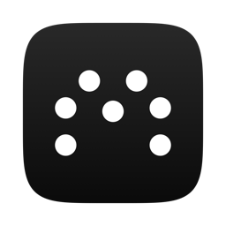

<p align="center"></p>
<h1 align="center">Mike</h1>
<p align="center">Calls, lectures and a library — living in your notch</p>
<p align="center">
  <a href="https://github.com/takeachangs/mike/releases/latest/download/Mike.dmg"></a>
</p>

Click the notch to:

- **Call**: talk to OpenAI's GPT-Live voice model (bring your own API key).
- **Listen**: transcribe a lecture or meeting live, on this Mac. The speech
  model (Parakeet Ultra) runs on the Neural Engine; audio is never saved
  or uploaded. The transcript has one paragraph per clock minute.
- **Library**: every past call and recording as a card. Search, read,
  copy, export, or move to the Trash.

Anywhere, **dictate** with the right ⌘ key: hold it and speak, or tap it
to start and tap again to stop (Esc cancels). The words are transcribed on
this Mac with the same model and pasted where your cursor is. The M's dots turn
while it gets ready, open into a circle with a soft cue when you can speak,
and a soft glow around the notch breathes with your voice. Needs Accessibility access; Settings
can turn it off.

While Mike runs, a small black tab sits to the left of the notch holding
seven white dots, the M from the icon. Click it (or the notch) for the
actions. During a session the dots morph through a circle while it loads
or the voice thinks, keep turning while the voice replies, and brighten
with your voice while it listens; the card then has the timer and the
pause/mute and stop/hang-up buttons. Short, quiet cue sounds
mark start, pause and stop.

It also works as the voice and recording front end for a coding agent:
the `/call` and `/listen` skills in `skill/` let a Claude Code session open
on a notes folder answer questions by voice or write notes from a
recording, with the same notch showing the session.

## Install

Requires macOS 14 or later on Apple Silicon.

Download `Mike-<version>.dmg` from the [latest release](https://github.com/takeachangs/mike/releases/latest)
and drag Mike to Applications. The app is not yet notarized, so macOS blocks the first launch; clear the download
flag once and it opens normally:

```bash
xattr -dr com.apple.quarantine /Applications/Mike.app
```

Or build it yourself, which needs no such step:

```bash
cd app && scripts/build-app.sh          # builds and signs dist/Mike.app (ad-hoc unless SIGN_IDENTITY is set)
scripts/install.sh --open               # quits a running copy, replaces /Applications/Mike.app, opens it
```

The first launch walks you through setup: allow the microphone, download
the speech model (about 600 MB, once), allow Accessibility for dictation,
paste an OpenAI API key if you want calls (it is stored in your Keychain),
and try a dictation. Settings has the same controls plus sound volume,
"Open at login" and "Run setup again…".

## Layout

```
app/                    the Swift package (see app/Package.swift)
  Sources/MikeKit  the library: recorder, dictation, Live call, state file, sessions, transcript, cues, Keychain
  Sources/Mike     the app: notch panel, dictation key and paste, Library, Settings
  Sources/Listen        the recorder as a command, for the /listen skill
  Tests/                swift-testing unit tests
  Resources/            Info.plist, entitlements, icon
  scripts/              build-app.sh, make-icon.swift, make-sounds.py, drive.py (fake session for the notch)
bridge.py               the agent-mode call: GPT-Live with client delegation, answered by a coding agent
prompt.txt              the generic voice prompt for agent-mode calls (`~/.mike/prompt.txt` overrides it)
skill/                  the agent-side /call and /listen procedures, installed into a notes folder
```

Runtime files live in `~/.mike/`, shared by the app, `bridge.py` and
the skills: `state.json` (what the notch draws), `listen-<stamp>.txt`
transcripts with optional `.md` notes, `transcript-<stamp>.json` calls, and
the agent-mode inbox and outbox.

## Develop

```bash
cd app && swift build && swift test     # build everything, run the unit tests
uv run bridge.py selftest               # the agent-mode bridge's offline checks
.build/debug/Mike                  # run the app from the build folder (from app/)
python3 scripts/drive.py                # cycle the notch through call states with no call (after a release build)
.build/release/Listen out.txt --file talk.wav   # play a recording through the recorder in real time
```

Releases: `SIGN_IDENTITY="Developer ID Application: …" NOTARY_PROFILE=<profile> scripts/build-app.sh`
signs with the hardened runtime, notarizes and staples. CI (`.github/workflows/ci.yml`) runs the tests and
builds the app on pull requests and pushes to main; `scripts/release.sh 1.0.1` tags a release, and CI publishes the zip
and DMG with notes listing every commit since the previous release.

## Agent mode

Point your coding agent at [SETUP.md](SETUP.md) and say "set this up". It
checks the prerequisites, builds the app, tests the key, personalises
a copy of `prompt.txt` in `~/.mike` and installs the skills into your notes folder.

## Thanks

Thanks to my dear friend Jack Baker for suggesting the name "Mike".

## License

GPL-3.0. See LICENSE.
